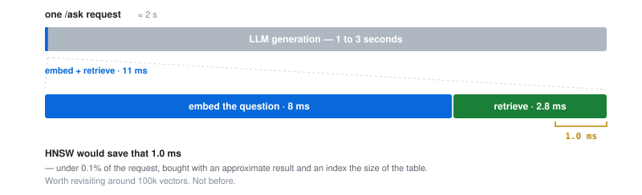

# Data model

[← README](../README.md) · siblings: [architecture](architecture.md) · [RAG](rag.md) · [API](api.md) · [evaluation](evaluation.md)

Nine tables in one Postgres.

- **Papers, authors and categories** are separate entities, joined by link tables.
- **Vectors live beside them** — same database, same transaction.
- **`app/models/` is the source of truth**; every migration is generated from it.

## How the tables relate

```
                    ┌─────────────┐
                    │  embedding  │   one vector per paper, same transaction
                    └──────┬──────┘
                           │ 1:1
                    ┌──────┴──────┐
        ┌───────────┤    paper    ├───────────┐
        │           └─────────────┘           │
   M:N  │ paper_author        paper_category  │  M:N
        │ (+ author order)                    │
  ┌─────┴─────┐                         ┌─────┴─────┐
  │  author   │                         │ category  │
  └───────────┘                         └───────────┘

  ingest_state        standalone — one watermark per sorted category set
```

## Schema

```
paper
  id                PK
  arxiv_id          UNIQUE        ← version-stripped; the idempotency key
  title             text
  abstract          text
  primary_category  text
  published         timestamptz   ← what the time series buckets on
  updated           timestamptz   ← what the watermark tracks
  doi               nullable
  journal_ref       nullable

embedding
  paper_id          PK, FK → paper  ON DELETE CASCADE
  vector            vector(384)
  content_hash      sha256(title + "\n" + abstract)   ← decides re-embedding
  model             which model produced it            ← so does this
  created_at        timestamptz

author                          category
  id      PK                      id    PK
  name    UNIQUE                  code  UNIQUE

paper_author                    paper_category
  paper_id   PK, FK               paper_id     PK, FK
  author_id  PK, FK               category_id  PK, FK
  position   smallint

ingest_state
  id                PK
  categories_key    UNIQUE        ← sorted set, e.g. "cs.AI|cs.CL|cs.LG"
  watermark         timestamptz
```

- **`doi` and `journal_ref` are nullable** — arXiv omits both for most preprints. Requiring
  them would reject the common case.
- **`position` preserves author order** — first and last author are not interchangeable with
  the middle of the list.

## Four decisions worth naming

### `arxiv_id` carries no version suffix and is unique

arXiv serves `2509.01234v3`; the paper is `2509.01234`.

- Stripping the version and marking it `UNIQUE` makes idempotency a **database constraint,
  not application logic** — `ON CONFLICT DO UPDATE`, never a read-then-write that can race.
- **Keeping the version would have been the subtle bug:** every revision lands as a new row,
  the corpus grows on every re-run, and `top-authors` counts the same paper repeatedly.

### `content_hash` + `model` decide re-embedding

The hash covers `title + "\n" + abstract` — exactly the text that gets embedded, nothing else.
Two consequences, both wanted:

- **A metadata-only revision costs nothing.** Adding a DOI bumps `updated`; the row refreshes,
  the hash does not change, no vector is recomputed.
- **Swapping models invalidates everything, through the same field.** `model` is part of the
  staleness check, so changing `EMBEDDING_MODEL` makes every vector stale automatically — no
  migration, no reconciliation step.

The hash is a change detector, never a retrieval artifact — similarity search never reads it.

### The watermark is keyed by the category set

Ingest `cs.AI`, then re-run adding `cs.LG`:

- **A shared watermark would stop the new run early** — `cs.LG` papers older than the mark
  look "already done", and every one is **silently skipped**.
- **Keying on the sorted set** makes a changed category list a different key. No mark is
  found, so the run does a full scan instead.

→ **[architecture.md](architecture.md)** — how the mark advances, and why a truncated run
refuses to move it.

### Embeddings are written in the paper's transaction

The vector is inserted in the same transaction as its paper. A crash between the two **is
not handled — it is impossible.** That is the whole case for pgvector over a separate store:

- **A dedicated vector DB means two systems and two writes** — the dual-write problem. A paper
  commits to Postgres, its vector never reaches the other store, and nobody finds out until a
  question fails to retrieve it.
- **One transaction removes the failure mode** rather than mitigating it.
- **No scale argument pulls the other way** — thousands of vectors, not billions.

## No indexes beyond the primary and unique keys

Measured, not assumed — warm medians of nine calls through the service functions themselves,
on the 2,370-paper corpus. Every plan is a sequential scan:

| Query | Median |
| --- | --- |
| `top-categories?n=10` | 4.5 ms |
| `top-authors?n=10` | 12.9 ms |
| `papers-over-time` (month, all) | 7.8 ms |
| `/ask` retrieval — top-5 of 2,370 vectors | 2.8 ms |

**Aggregations gain nothing.** An index buys selectivity; a `GROUP BY` over the whole corpus
has none — Postgres reads every row regardless.

**Vector search genuinely would be faster.** HNSW over the same 2,370 vectors
(`EXPLAIN ANALYZE`, warm median of seven):

| | Exact (today) | HNSW |
| --- | --- | --- |
| Execution | 1.18 ms | **0.14 ms** |
| Result | exact | **approximate** |
| Build | — | 410 ms |
| Index size | — | 4752 kB, on a 4760 kB table |

8.7× faster — and not worth it, because of where that millisecond sits:

<p align="center">
  <picture>
    <source media="(prefers-color-scheme: dark)" srcset="img/latency-dark.svg">
    
  </picture>
</p>

The trade: **under 0.1% of end-to-end latency, bought with an approximate result and an index
the size of the table.** Worth revisiting around 100k vectors — not before.

## Migrations

- **Generated from `app/models`, then read before committing.** Autogenerate reliably misses
  server defaults, constraint changes and custom column types — the `vector` column included.
- **The first migration runs `CREATE EXTENSION IF NOT EXISTS vector`**, so a fresh empty
  Postgres reaches a working schema with one command.
- **`MetaData` carries a `naming_convention`**, so constraint and index names are
  deterministic rather than autogenerated noise.

- **The container entrypoint runs `alembic upgrade head`** before the API starts.
- **The test suite builds `arxiv_test` from the same migrations** — the schema under test is
  the schema that ships.
