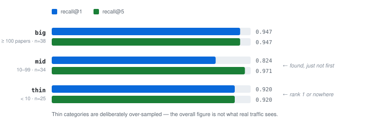
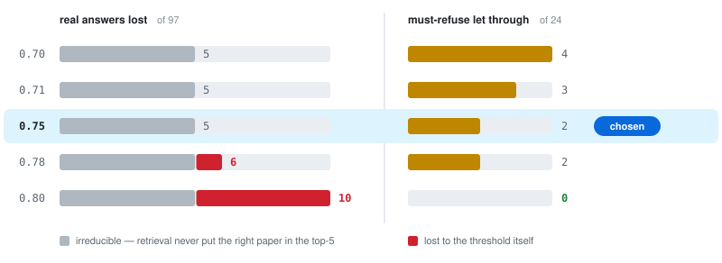
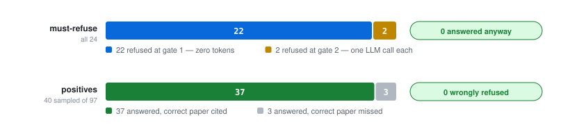

# Evaluation — method

[← README](../README.md) · siblings: [architecture](architecture.md) · [data model](data-model.md) · [RAG](rag.md) · [API](api.md)

> **This doc is the method** — how the labelled set is built, what the metrics mean, and
> what each number is allowed to claim. The dated run log, the before/after of every method
> change, and the raw per-run output live in [`eval/RESULTS.md`](../eval/RESULTS.md).

Tests prove the code runs. They say nothing about whether the *right papers come back*, or
what the relevance gate costs in answers it wrongly throws away. Those are different
questions and they need a labelled set, not assertions.

```bash
uv run python scripts/evaluate.py             # retrieval + threshold sweep — offline, free
uv run python scripts/evaluate.py --with-llm  # + end-to-end answer/refuse behaviour
```

The offline report needs no API key and costs nothing, which is the point: it is cheap
enough to run on every change to retrieval.

## The dataset

[`eval/golden.jsonl`](../eval/golden.jsonl) — 121 rows, committed, built by
[`scripts/build_golden_set.py`](../scripts/build_golden_set.py).

| Kind | n | Source |
| --- | --- | --- |
| Positives — `big` band (category ≥ 100 papers) | 38 | generated |
| Positives — `mid` band (10–99) | 34 | generated |
| Positives — `thin` band (< 10) | 25 | generated |
| Negatives — adjacent computer science | 14 | **hand-written** |
| Negatives — off-topic | 10 | **hand-written** |

### Three construction rules, each fixing a way this goes wrong

> [!IMPORTANT]
> **Positives are authored paper-first.** Sample a paper, then generate a question its
> abstract answers. The reverse — ask a question, then label whatever retrieval returned —
> makes `recall@5 = 1.0` by construction and measures nothing at all.

**Stratified by each paper's *rarest* category.** Five categories hold most of the corpus,
so a uniform sample would test retrieval almost exclusively where it is densest, and report
a number that says nothing about the long tail.

**Negatives are hand-written, not generated.** Asking a model for "questions about things
absent from this corpus" reliably produces things present in it — it has no view of what the
corpus contains. The 14 *adjacent* negatives are the ones that matter: real computer science
that this corpus does not cover, which is where a naive threshold fails.

**Leakage guard.** The generator rejects any question lifting five consecutive words from
the paper's title, which narrows the vocabulary overlap without closing it.

## Retrieval (97 positives · 2,370 papers · 16 Sep 2026)

| Metric | Overall | | Band | n | recall@1 | recall@5 | MRR |
| --- | --- | --- | --- | --- | --- | --- | --- |
| recall@1 | 0.897 | | `big` (≥ 100 papers) | 38 | 0.947 | 0.947 | 0.955 |
| recall@5 | **0.948** | | `mid` (10–99) | 34 | 0.824 | 0.971 | 0.875 |
| recall@10 | 0.979 | | `thin` (< 10) | 25 | 0.920 | 0.920 | 0.920 |
| MRR@20 | 0.918 | | | | | | |

<p align="center">
  <picture>
    <source media="(prefers-color-scheme: dark)" srcset="img/recall-dark.svg">
    
  </picture>
</p>

Bands are reported separately because thin categories are deliberately over-sampled — **the
overall figure is not what real traffic sees.** The shape is what's interesting:

- `mid` has the **worst recall@1 and the best recall@5**. The right paper is found; it just
  isn't first. That is a ranking problem, and it is exactly what a cross-encoder re-rank
  fixes.
- `thin` is flat across every `k`. Rank 1 or nowhere — with under 10 papers in a category
  there is no near-miss to climb.

> [!NOTE]
> **Not precision@k.** With one relevant paper per question, `precision@5` cannot exceed 0.2
> however perfect the ranking. `recall@k` here is hit-rate@k.

## The threshold sweep

Each candidate threshold is scored through `fit_context` — the real code path — on both
halves of the set at once: the real answers it **throws away**, and the must-refuse questions
it **lets through**.

<p align="center">
  <picture>
    <source media="(prefers-color-scheme: dark)" srcset="img/threshold-dark.svg">
    
  </picture>
</p>

Retrieval puts the correct paper in the top-5 for 92 of the 97 — a ceiling no threshold
can beat, because **a gate cannot repair retrieval, only avoid discarding what it found.**
Everything from 0.70 to 0.76 sits at that ceiling, so the negatives decide.

The selection rule, stated before looking at the numbers: **the lowest threshold that
reaches the fewest false passes while staying at the retrieval ceiling.** That is `0.75`.

`0.80` refuses every negative — and costs five real answers to do it. The residue is handled
by gate 2 instead, for one LLM call on two questions out of 24. Full analysis of the two
survivors: [RAG](rag.md#the-remaining-overlap-is-structural).

## End to end, through `/ask`

All 24 must-refuse questions, plus a fixed-seed sample of 40 of the 97 positives.

The asymmetry is deliberate. **Every negative runs**, because they are the point and they
are nearly free — 22 of the 24 never reach the model at all. **Positives are sampled**,
because each one necessarily costs an LLM call, and their retrieval is already measured
exactly, and for nothing, by the offline report.

<p align="center">
  <picture>
    <source media="(prefers-color-scheme: dark)" srcset="img/gates-dark.svg">
    
  </picture>
</p>

| Positives (40) | | Must-refuse (24) | |
| --- | --- | --- | --- |
| answered, correct paper cited | 37/40 | refused at gate 1 — 0 LLM calls | 22/24 |
| answered, correct paper missed | 3/40 | refused at gate 2 — 1 LLM call | 2/24 |
| **wrongly refused** | **0/40** | **answered anyway** | **0/24** |

The sweep **named both gate-1 survivors in advance** — Raft and consistent hashing — and the
grounded prompt refused both. The offline report predicted the live behaviour rather than
being reconciled with it after the fact.

The offline sweep predicts 92/97 = 94.8% answerable with the right paper cited; live gives
37/40 = 92.5%. Within sampling noise — which is what licenses using the free offline report
while iterating and paying for the 20-minute one only at the end.

## What this replaced

Threshold selection began as *"find a gap between three score ranges"* — a question with no
answer when the ranges overlap. They do.

| | Before — range separation | After — labelled classification |
| --- | --- | --- |
| Data | 23 hand-written questions | 121 rows, 97 generated paper-first |
| Question asked | is there a gap? | what does each threshold cost? |
| Output | `NO SEPARABLE WINDOW`, no recommendation | `0.75`, derived from a stated rule |
| `RETRIEVAL_TOP_K` | a convention | measured: +2.1pp for +34% context |

The overlap did not go away. It became a **trade-off curve with a priced answer** instead of
a dead end. Both method changes are recorded in
[`eval/RESULTS.md`](../eval/RESULTS.md#method-changes--two-rules-that-were-wrong).

## Limits

- **Recall is an upper bound.** Questions were generated from the abstracts they point at,
  so they share vocabulary with their target in a way real user questions do not. The
  five-consecutive-title-words guard narrows that gap without closing it. Read `0.948` as a
  ceiling, not a forecast.
- **Single-label ground truth.** One correct paper per question, though others may well be
  relevant — which is exactly what rules out `precision@k` and `nDCG`.
- **Bound to its corpus.** arXiv has no "as of" query, so a corpus ingested another day is a
  different corpus. `golden.meta.json` records the fingerprint; papers missing from the
  current database are reported **skipped**, never counted as retrieval failures.
- **Answer text is not scored.** Faithfulness and answer relevance need an LLM judge
  validated against human labels, or RAGAS. The end-to-end report checks **citation and
  refusal, not prose.**
